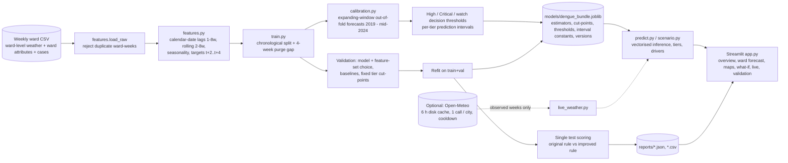

# Architecture

> Data provenance warning: the supplied weekly dataset looks **synthetic** and its origin is undocumented. Everything below describes a method that works on this data; it is not evidence of real-world forecasting accuracy.

## 1. System and data flow

Everything except the dotted live-weather branch works **offline**. No LLM is called at any point.

**Timing convention.** A forecast for week *t* is issued at the end of week *t* and uses only weather observed up to week *t* (current + lags 1-8 + trailing rolls).
The target is reported cases in weeks *t+2 … t+4* (also each single week); week *t+1* is the unavoidable blind week.

## 2. Weather lag pipeline (`src/features.py`)
* Input columns: `avg_temp_c`, `rainfall_mm`, `relative_humidity_pct` (ward-level, weekly, in the supplied dataset) plus `population_density_sqkm`, `water_logging_risk_index`, `sanitation_score`.
* Every shift goes through one function, `value_at_offset(df, values, weeks)`, which looks up the same `ward_id` at calendar date `t + weeks`. **Nothing shifts by row position**, so a missing week yields NaN features for exactly the rows that depend on it (previously a positional `shift(k)` would silently have used a different week's value).
* Features per weather variable: lags 1-8 weeks; trailing windows of 2/3/4/6/8 weeks ending at *t* (sum for rain, mean for temperature/humidity; NaN if any week in the window is missing); plus week-of-year sin/cos → 47 model inputs including the 3 ward attributes.
* `load_raw` / `add_weather_features` / `value_at_offset` raise on duplicate `(ward_id, date)` records. The shipped dataset has none and no calendar gaps (checked by `src.selfcheck`).
* Tests (`tests/test_feature_alignment.py`) compare every lag, rolling window and target with an independent date-lookup on data with deleted weeks, and assert that altering anything after a cut-off date cannot change earlier features. `tools/mutation_check.py` re-introduces ten bugs (positional lags, forward-looking lags, partial rolling windows, positional targets, accepted duplicates, intervals not containing the forecast, ignored false-alarm budget, calibration leaking into the test period) and verifies the suite turns red for each.

## 3. Chronological validation split
| Split | Forecast dates | Rows | Used for |
|---|---|---|---|
| Train | 2016-02 → 2022-11 | 21,180 | fitting candidates, tier cut-points |
| Validation | 2023-01 → 2024-05 | 4,440 | model / feature-set selection |
| Out-of-fold calibration | expanding windows, test years 2019, 2020, 2021, 2022, 2023, Jan-May 2024 | 15,600 | High/Critical/watch thresholds, interval calibration, scorer comparison |
| Test | 2024-07 → 2025-12 | 4,500 | scored once, reporting only |

A 4-week purge gap (= longest horizon) stops target windows crossing a boundary. Each out-of-fold season is predicted by a model trained only on data ending ≥ 4 weeks earlier; the last fold stops before the test period (asserted in code and tests). Every model and baseline is scored on identical rows (validation/test rows need a seasonal-naive reference 52 weeks earlier). The deployed model is refit on train+val.

## 4. Model and selection rationale
* **Model:** HistGradientBoosting with Poisson loss on weather-only features. Candidates on validation MAE (weeks 2-4 total): Mean 10.12 · Persistence 5.38 · Seasonal-naive 3.47 · Ridge 3.09 · ExtraTrees 2.05 · RandomForest 1.97 · HistGB-squared 1.88 · **HistGB-Poisson 1.86**. Poisson boosting suits zero-heavy non-negative counts, rain-lag × ward-vulnerability interactions and trains on CPU in seconds. Case-history features gave no validation gain (> 3% needed) and are unavailable for new wards.
* **Forecast strategy:** direct per-horizon models beat one pooled model and window/3 on validation (mean MAE 1.003 / 1.006 / 1.105). Hyper-parameter search gained 1.3% (< 2% bar), defaults kept.
* **Fragility note:** feature differences below 1e-12 moved validation MAE by 1.7% (1.825 → 1.856) and flipped an earlier kappa-based choice of tier percentiles, so the tier percentiles are now fixed policy parameters (kappa is reported only as a sensitivity table).

## 5. Prediction, risk classification and intervals
* **Point forecast** = expected cases in the window for a ward-week. **Tiers (fixed policy):** Medium / High / Critical start at the 70th / 90th / 97th percentile of the *training-period* window total → 10 / 27 / 41 cases for weeks 2-4. These are dataset-relative cut-points, **not official public-health thresholds**; there is no external justification for them beyond "the top 10% / 3% of ward-weeks in training".
* **Why decision thresholds differ from cut-points.** A mean forecast shrinks toward the average, so at outbreak levels it under-predicts (on out-of-fold data mean actual > mean predicted in every level above 5 cases) and `pred ≥ 27` misses many true High weeks. `calibration.select_escalation` picks, per level, the **lowest threshold whose false-alarm rate on pooled out-of-fold forecasts stays within a budget**: High 5% → predicted ≥ 22.3, Critical 2% → ≥ 32.8, watch 10% → ≥ 17.6 (weeks 2-4 window; other windows have their own). Low/Medium use the cut-points. `point_tier` (original rule) is still returned for transparency.
* **Alternatives evaluated chronologically and rejected:** (a) persistence escalation (flag only after two consecutive high forecasts) - worse recall at matched false-alarm rate; (b) a classifier for P(y ≥ High) and a 70th-percentile quantile model - PR-AUC 0.83 / 0.84 vs 0.82 and recall at 5% false alarms 0.80 / 0.82 vs 0.81, below the pre-set +3-point adoption bar (`reports/risk_scorer_alternatives_oof.csv`). Ranking quality is therefore unchanged; the gain comes from the operating point.
* **Intervals (80%):** residual / sqrt(forecast + 1), conformal quantiles calibrated separately for each predicted-risk tier, with separate lower and upper constants (Mondrian conformal). Chosen over a single global constant on a held-out chronological slice of the out-of-fold data. The interval always contains the point forecast (tested). Honest caveat: coverage conditional on the *actual* tier is not guaranteed - weeks that turn out Critical are the ones where the forecast was too low.
* **Explanations:** grouped what-if occlusion per ward-week (change vs seasonal-normal) and grouped permutation importance. Not causal.

## 6. Original vs improved (test, weeks 2-4 window, same model and rows)
| | Original | Improved |
|---|---|---|
| Missed High/Critical (of 432) | 127 | 40 |
| High/Critical recall · precision · false-alarm rate | 71% · 55% · 6.2% | 91% · 44% · 12.3% |
| Critical recall · precision | 42% · 24% | 72% · 14% |
| Interval coverage on weeks that were Critical (n = 53) | 47% | 94% |
| Overall interval coverage · width | 95% · 13.3 | 91% · 11.9 |
| MAE · RMSE · PR-AUC | 2.64 · 4.92 · 0.66 | unchanged |
| Baselines on the same rows (MAE) | Seasonal-naive 4.03 · Persistence 6.22 | - |
Limitations of this evidence: the false-alarm budget (5%) was exceeded on test (12.3%) because the test seasons were over-predicted relative to earlier seasons; Critical flags are noisy; PR-AUC does not change; the data are synthetic. Per horizon, ward, season and tier tables are in `reports/` (`risk_comparison_original_vs_improved.csv`, `test_by_*.csv`).

## 7. Dashboard
`app.py` (Streamlit): sidebar window / city / ward / date → Overview banner and KPIs (Critical, High, watch-only wards), ward forecast for weeks 2/3/4 + total with intervals and driver bars, ward×week risk heatmap and ranking, what-if editor (same feature code and bundle), optional live tab, validation tab (original-vs-improved table, PR curve, calibration by risk tier, false-negative panel). All validation numbers are read from `reports/`, never hard-coded.

## 8. Compute and API cost controls
| Control | Where | Effect |
|---|---|---|
| Serialized model (joblib, 2.4 MB, no pandas objects, library versions recorded) | `model_io.py` | no training at launch; automatic rebuild (~75 s) only if the bundle is unreadable on this machine |
| Load once, compute once | `st.cache_resource`, `st.cache_data` | feature table and all-ward batch inference cached per window; ward/date changes are lookups (cached rerun 0.5 s) |
| Vectorised batch inference | `predict.py` | 5,000 ward-weeks scored in ~0.1 s (`src.selfcheck`) |
| Zero runtime API/LLM calls by default | - | $0 marginal cost, nothing to rate-limit |
| Optional live weather: **1 request per city**, `past_days=70` covers all 9 lag weeks, 6 h disk cache, stale-cache fallback, 8 s timeout, **10-minute cooldown after any failure / HTTP 429**, `LIVE_WEATHER_OFFLINE=1` kill switch | `live_weather.py` | ≤ 5 requests per refresh, never per ward or per rerun; failures never raise into the UI |
| Config via environment variables | `live_weather.py` | no secrets in code |
| LLM text summaries | not implemented | would be templated and cached per ward-tier-week with a token cap |

## 9. Geography, provenance and limits
The dataset's weather is **ward-level and historical**. The optional live layer is **city-level** (one coordinate per city, approximate centres) and a different source from the training data. No ward coordinates exist, so no ward-level geographic map is drawn (a verified `data/ward_coordinates.csv` enables one). Observed (CSV), live observed and what-if inputs are labelled separately; forecast weather is never fed into lag features. The application predicts expected reported cases from observed weather and static ward attributes; it cannot establish causality, real-world accuracy, forecast-weather skill or official alert levels.
